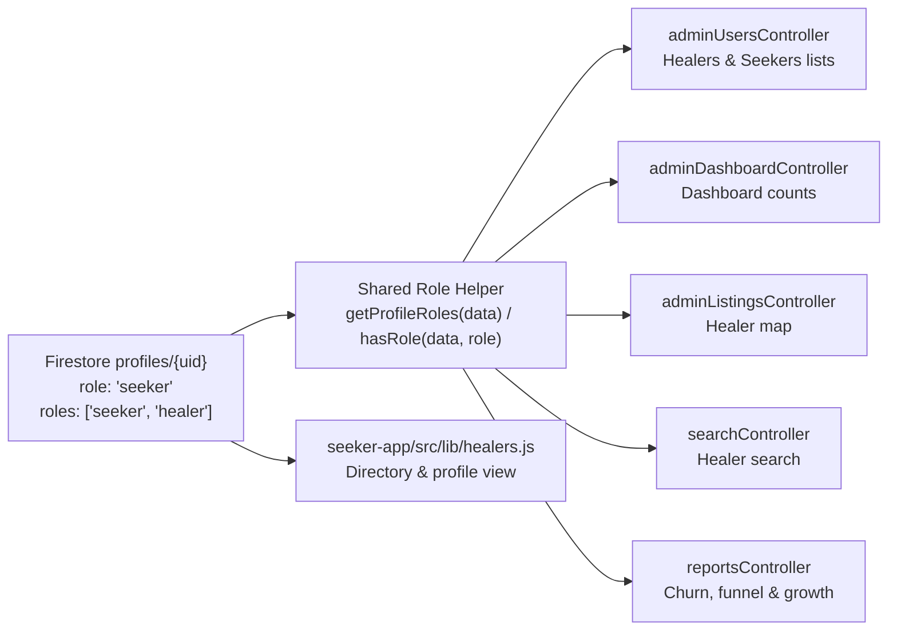

# Implementation Plan: Standardize Profile Role Lookups on `roles[]`

## Goal Description

Currently, `profiles/{uid}` documents store both a legacy single string `role` (the user's initial registration role) and a `roles[]` array (all roles the user holds, e.g. `["seeker", "healer"]`). While authentication checks and parts of reporting already read `roles[]`, several core queries still filter strictly by `where('role', '==', ...)`.

As a result, **dual-role users are invisible under their secondary role** in:
- Admin Console **Healers** and **Seekers** lists (`backend-server/controllers/adminUsersController.js`)
- Admin Dashboard total counts (`backend-server/controllers/adminDashboardController.js`)
- Admin Listings healer name lookup (`backend-server/controllers/adminListingsController.js`)
- Healer Search API (`backend-server/controllers/searchController.js`)
- Seeker App Healer Directory & Profile page (`seeker-app/src/lib/healers.js`)
- Parts of User & Platform Reports (`backend-server/controllers/reportsController.js`)

This plan migrates all `profiles` role queries and checks to use `roles[]` as the primary source of truth while preserving backwards compatibility for legacy documents that only have `role`.

---

## User Review Required

> [!IMPORTANT]
> **Firestore Single `array-contains` Limit (`seeker-app/src/lib/healers.js`)**
> Firestore allows **at most one** `array-contains` or `array-contains-any` clause per query. `getAllHealers` currently supports `where('modalities', 'array-contains-any', filters.modalities)`.
> Switching the role filter to `where('roles', 'array-contains', 'healer')` means **`filters.modalities` must be filtered client-side** in JS after fetching healers, otherwise Firestore will throw a runtime error whenever modality filters are applied.

> [!WARNING]
> **Firestore Composite Index Requirement**
> Changing `getAllHealers` in `seeker-app/src/lib/healers.js` to:
> ```js
> where('roles', 'array-contains', 'healer'),
> where('onboarding_complete', '==', true),
> orderBy('created_at', 'desc')
> ```
> will require a Firestore composite index on `profiles` (`roles` Arrays, `onboarding_complete` Ascending, `created_at` Descending). If you prefer to avoid deploying a new index immediately, we can sort by `created_at` client-side instead.

> [!NOTE]
> **Backwards Compatibility for Legacy Profiles**
> Older `profiles` documents created before `roles[]` existed may only have `role: "healer"` or `role: "seeker"` and no `roles` array.
> - Firestore `where('roles', 'array-contains', ...)` **will not match** documents missing `roles[]`.
> - To ensure zero data loss, this plan includes **both**:
>   1. Dual-query merging (`roles array-contains X` + `role == X`, deduplicated by doc ID) in backend controllers until all docs are migrated.
>   2. An optional, idempotent one-time backfill script (`backend-server/scripts/backfillProfileRoles.js`) with `--dry-run` support to populate `roles[]` on all legacy profiles.
> - The legacy `role` field will **continue to be written** (not removed) so no external integrations or older clients break.

---

## Open Questions

> [!IMPORTANT]
> Please confirm your preference on these two points before implementation:
> 1. **Backfill Script**: Should we include and run `backend-server/scripts/backfillProfileRoles.js` (dry-run first) to populate `roles[]` on all legacy `profiles` docs?
> 2. **Admin Dashboard Counts**: Should a dual-role user (`roles: ['seeker', 'healer']`) be counted in **both** `totalHealers` and `totalSeekers` on the Admin Dashboard (consistent with `reportsController.js`), or only under their initial `role`?

---

## Proposed Changes

### Architecture Overview



---

### Backend (`backend-server`)

#### [NEW] `backend-server/utils/profileRoles.js`
Create a small, reusable utility for consistent role resolution across all backend controllers:
```js
const { collection, getDocs, limit, query, where } = require('firebase/firestore');

const getProfileRoles = (data = {}) => {
  const raw = Array.isArray(data.roles)
    ? data.roles
    : [data.role, data.type].filter(Boolean);
  return Array.from(new Set(raw.map((r) => String(r).toLowerCase().trim()).filter(Boolean)));
};

const hasRole = (data = {}, targetRole) => {
  const normalized = String(targetRole || '').toLowerCase().trim();
  if (!normalized) return false;
  return getProfileRoles(data).includes(normalized);
};

// Queries both `roles array-contains targetRole` and legacy `role == targetRole`, deduplicated by doc.id
const queryProfilesByRole = async (db, targetRole, maxLimit = 250) => {
  const profilesRef = collection(db, 'profiles');
  const [byRolesSnap, byLegacyRoleSnap] = await Promise.all([
    getDocs(query(profilesRef, where('roles', 'array-contains', targetRole), limit(maxLimit))),
    getDocs(query(profilesRef, where('role', '==', targetRole), limit(maxLimit))),
  ]);

  const merged = new Map();
  for (const docSnap of byRolesSnap.docs) merged.set(docSnap.id, docSnap);
  for (const docSnap of byLegacyRoleSnap.docs) {
    if (!merged.has(docSnap.id)) merged.set(docSnap.id, docSnap);
  }
  return Array.from(merged.values());
};

module.exports = { getProfileRoles, hasRole, queryProfilesByRole };
```

#### [NEW] `backend-server/scripts/backfillProfileRoles.js`
One-time idempotent migration script (`--dry-run` by default, `--apply` to write):
- Scans `profiles` collection.
- For any document where `roles` is missing or doesn't include `role`/`type`, writes `roles: Array.from(new Set([...existingRoles, role, type].filter(Boolean)))`.

#### [MODIFY] `backend-server/controllers/adminUsersController.js`
- Replace `listProfilesByRole(role)` (`where('role', '==', role)`) with `queryProfilesByRole(db, role, 250)`.
- Dual-role users will appear in both **Healers** and **Seekers** lists in the Admin Console.

#### [MODIFY] `backend-server/controllers/adminDashboardController.js`
- Update `totalHealers` and `totalSeekers` counting to check `roles[]` (via `queryProfilesByRole` or `getCountFromServer(where('roles', 'array-contains', ...))` once backfilled).

#### [MODIFY] `backend-server/controllers/adminListingsController.js`
- Update `loadHealerMap(db)` to use `queryProfilesByRole(db, 'healer', 300)` instead of `where('role', '==', 'healer')`, ensuring dual-role healers' names resolve properly on listings.

#### [MODIFY] `backend-server/controllers/searchController.js`
- In both `searchHealers` and `adminSearchHealers`, replace:
  ```js
  if (d.role && String(d.role).toLowerCase() !== 'healer') { return false; }
  ```
  with:
  ```js
  if (!hasRole(d, 'healer')) { return false; }
  ```

#### [MODIFY] `backend-server/controllers/reportsController.js`
- Replace remaining single-role checks (`profile.role === 'healer'`, `profile.role === 'seeker'`, `p.role === 'healer'`, `p.role === 'seeker'`) at lines 241–242, 256–257, 1107, 1138, 1189–1190 with `hasRole(profile, 'healer')` / `hasRole(profile, 'seeker')` so churn, funnel, and platform growth metrics match the rest of the report.

---

### Seeker App (`seeker-app`)

#### [MODIFY] `seeker-app/src/lib/healers.js`
- Add a local `hasRole(data, targetRole)` helper (checking `roles[]` with fallback to `role`/`type`).
- Update `getAllHealers(filters)`:
  - Query both `where('roles', 'array-contains', 'healer')` + `where('onboarding_complete', '==', true)` and legacy `where('role', '==', 'healer')` + `where('onboarding_complete', '==', true)` (deduplicated by doc ID) — or single `roles array-contains` query after backfill.
  - Apply `filters.modalities` and `created_at` descending sort client-side (avoids Firestore's 1 `array-contains` per query limit and avoids requiring a new composite index).
- Update `getHealerById(healerId)`:
  - Replace `if (healerData.role !== 'healer')` with `if (!hasRole(healerData, 'healer'))`.

---

### Explicitly Out of Scope (Keep Untouched)
- **`reviews` collection queries** in `seeker-app/src/lib/reviews.js` and `healer-app/src/lib/reviews.js`: `where('role', '==', 'seeker')` refers to the author role on a `reviews` document, not a `profiles` document.
- **`role` field on writes**: Kept intact for backwards compatibility as the initial registration role.

---

## Verification Plan

### Automated Checks
- `node --check` on all modified/created files in `backend-server` (`utils/profileRoles.js`, `scripts/backfillProfileRoles.js`, and all 5 modified controllers).
- `esbuild` JSX/JS syntax verification on `seeker-app/src/lib/healers.js`.
- Run `node scripts/backfillProfileRoles.js --dry-run` (if approved) to verify how many legacy docs need `roles[]` populated before writing anything.

### Manual Verification
1. Use a dual-role test account that originally signed up as a **Seeker** and later added the **Healer** role (`role: "seeker"`, `roles: ["seeker", "healer"]`).
2. **Admin Console**: Verify the user appears in **both** `/users/seekers` and `/users/healers`, and that suspending the seeker role leaves the healer role active.
3. **Seeker App**: Verify the dual-role healer appears in Healer Search (`/healers`), modality-filtered search, and their profile page (`/healers/:id`) loads without `"User is not a healer"`.
4. **Admin Reports & Dashboard**: Verify counts and growth metrics include dual-role users accurately.
